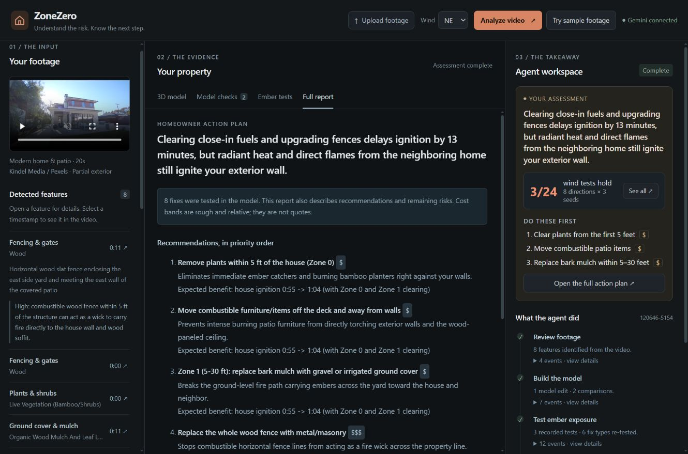
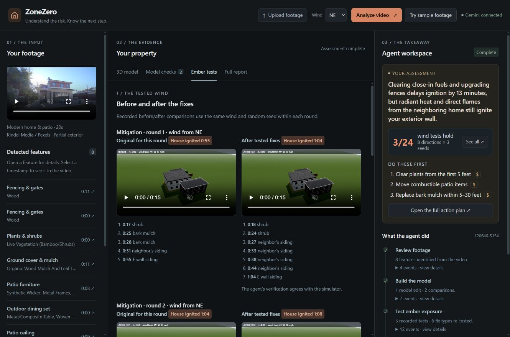
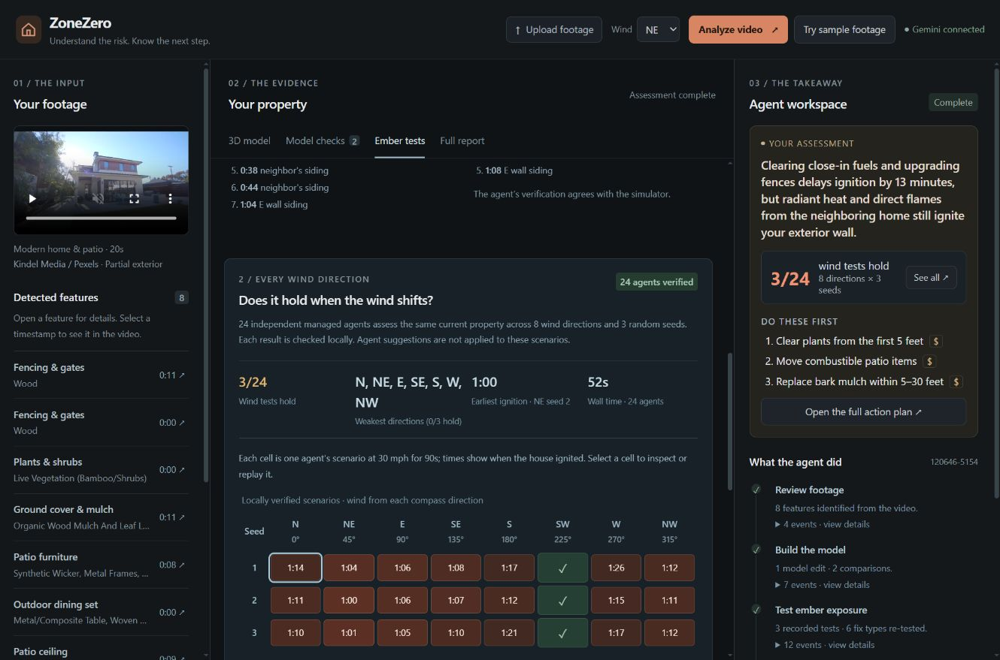
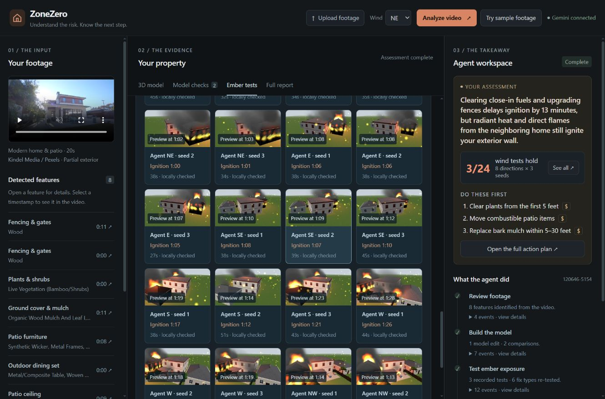
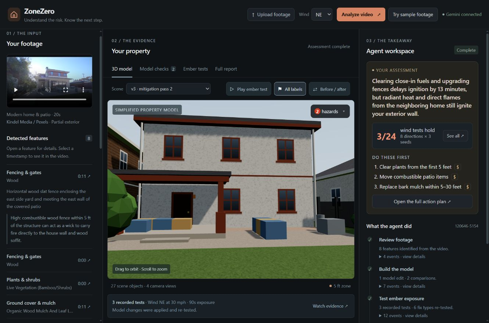
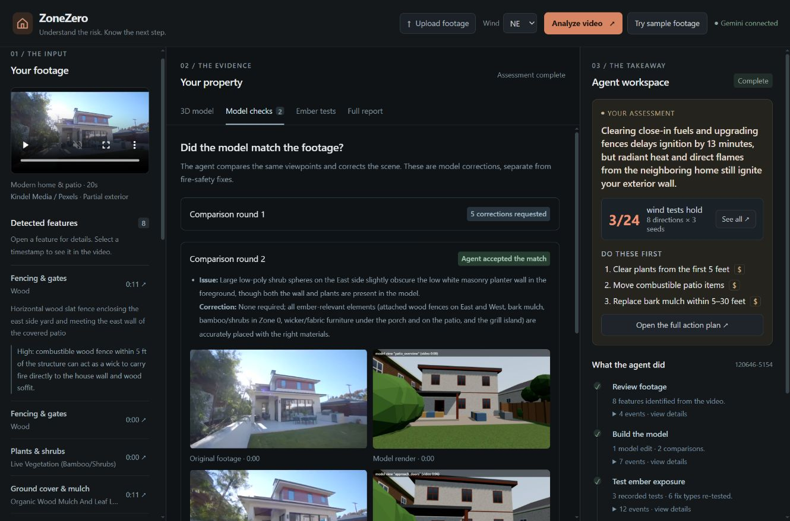

# ZoneZero: complete UI/UX audit and redesign proposal

**Reviewed:** October 25, 2026

**Source:** `main` at `b24d897` — “Ember tests redesign, readable type, honest takeaway, opt-in swarm before report”

**Deliverable:** analysis and redesign specification; application behavior has not been changed by this audit.

## 1. Overall assessment

ZoneZero contains useful evidence, but the user still has to assemble the conclusion themselves. Footage observations, model versions, successive mitigation tests, the 24-agent swarm, and the report describe related work using different scopes, counts, and wording. More cards or a different color palette will not resolve that problem on their own.

The redesign should make three answers immediate:

1. **What happened to this property in the tests?**
2. **What did the agent change in the model, and what difference did that make?**
3. **What should I do next, and which suggestions remain untested?**

Keep the dark, three-panel workspace and its existing center views. Improve the reading order, shared result data, and connections between panels. The left should establish the evidence, the center should explain the result, and the right should summarize the decision. They should feel like three views of one assessment.

### What to preserve

- One workspace containing footage, the model, evidence, and the agent result.
- The current dark visual character and substantial 3D viewport.
- Center navigation between model, model checks, ember tests, and action plan.
- Timestamp links back to footage and real-frame/model comparisons.
- Separate scenario agents, locally verified results, and access to **every scenario's preview and diagnosis**.
- Clear statements that model changes are digital and simulations are planning aids.
- Detail on demand for logs, remote IDs, timings, and prior rounds.

Do not reintroduce a separate overview/activity dashboard, a white dashboard theme, or prominent orange dialogue boxes down the left side. Those would conflict with the workspace preference already expressed.

## 2. Review method and limits

The review combined live browser inspection at **1331 × 879**, accessibility-tree inspection, read-only DOM measurements, and source review. All four center views, an expanded observation, coverage notes, additional-test controls, the swarm matrix, scenario information, and the expanded preview collection were inspected. The main panels measured 280 px left, 696 px center, and 355 px right at this viewport.

The saved assessment was `120646-5154`, based on the Kindel Media/Pexels house-and-patio clip. It provides a useful completed example with model corrections, mitigation rounds, a report, and a completed concurrent swarm. No new paid assessment or swarm was launched for this audit.

Findings below distinguish **observed** behavior from **source-confirmed** behavior and **proposals**. Empty, failed, cancelled, and partially completed states were reviewed in source; they were not recreated through fault injection. Narrow-screen concerns are based on CSS inspection, not a completed device matrix. Accessibility recommendations are an implementation checklist, not a claim of a completed accessibility certification or user study.

### Current evidence, before interpreting it

| Item | Saved result |
|---|---|
| Footage coverage | Approximately 20 seconds; partial exterior |
| Model review | 2 comparison rounds; 1 model correction |
| Original tested property | Scene v1, NE wind, seed 7; house ignition at **0:55** |
| First mitigation result | Scene v2; house ignition at **1:04** |
| Final mitigation result | Scene v3; house ignition at **1:08** |
| Tested changes | 6 distinct fix types; 8 distinct target applications |
| Swarm conditions | Same scene v3; 8 directions × 3 seeds; 30 mph; 90 simulated seconds |
| Swarm outcomes | **21 scenarios with house ignition; 3 without house ignition** |
| No-ignition cases | All 3 SW trials |
| Earliest swarm ignition | NE, seed 2, at **1:00** |
| Swarm completion | 24 distinct jobs, locally checked; **52.54 seconds wall time** |

These are outcomes of selected simulations, not estimates of real-world ignition probability. The swarm duration excludes the earlier video-to-model assessment. See [the measured benchmark](SWARM_BENCHMARK.md) for timing context and its limitations.

## 3. What the latest changes already improved

The latest commit is a useful step forward. It already puts the tested-wind comparison before the all-winds section, adds swarm result metrics and direction totals, collapses the preview collection, labels suggestions as untested, and summarizes agent activity by phase. It also puts three priorities in the takeaway, hides the duplicate long recommendation list there, and supports running an opted-in swarm before report generation.

Those improvements should be retained. The remaining problem is that the **default first read still follows execution history**, while the conclusion is split across several places. The report headline also becomes the takeaway headline, so a long or incorrect generated sentence spreads through the interface.

## 4. Priority findings

Priority here describes implementation order: **P0 = misleading interpretation or inconsistent evidence**, **P1 = major comprehension/navigation work**, **P2 = refinement**.

| ID | Priority | Evidence | Problem and proposed correction |
|---|---|---|---|
| F01 | P0 | Observed + source | The report and takeaway say the fixes delay ignition by **13 minutes**. Displayed results change from 0:55 to 1:08: **13 seconds**. Build factual result sentences from numeric simulation fields, with explicit units; do not let generated prose calculate them. |
| F02 | P0 | Observed + source | An older single-wind report is shown beside a newer 24-case swarm verdict. Standalone swarm and new-wind routes do not regenerate the report. Version reports against their input tests; show “New tests available — update action plan” until refreshed. |
| F03 | P0 | Source | Takeaway success color uses `holds === checked`, even when fewer than 24 cases are checked. One checked pass can therefore receive success styling while 23 cases remain unknown. Completion coverage and outcome must be separate; partial work must never read as an all-scenarios conclusion. |
| F04 | P0 | Observed + source | “Expected benefit” repeats one multi-fix comparison under several individual actions. That can imply each action caused the full improvement. Attach the effect to the **tested set**, and label individual benefit as unisolated unless separately tested. |
| F05 | P0 | Observed + source | Original footage observations, the current mitigated scene, a frozen swarm scene, and report priorities can refer to different property states. Add a shared scope label and snapshot links. Mark old scenario results as results for their saved scene when the property changes. |
| F06 | P1 | Observed | Ember tests start with round 1 and long ignition chains. The final original-to-current comparison and 24-case conclusion require scrolling and arithmetic. Lead with the final result; put the round history behind disclosure. |
| F07 | P1 | Observed | “3/24 wind tests hold,” “weakest directions,” ignition time, agent duration, and wall time compete for attention. Lead with the physical outcome and scope, then explain the path; keep computation timing secondary. |
| F08 | P1 | Observed | The report is a long headline, explanatory note, five expanded recommendations, and a partly repeated checklist. Replace its default view with a short action plan and expandable evidence. |
| F09 | P1 | Observed + source | Scene changes and scenario replays change the meaning of the workspace without a persistent breadcrumb or clear return action. Add explicit assessment/scenario context and preserve it in navigation. |
| F10 | P1 | Observed + source | “Test wind” can apply more model fixes, while the swarm tests a frozen property without applying suggestions. These neighboring controls imply similar operations. State the different effects directly and show them before launch. |
| F11 | P1 | Observed + source | Important coverage gaps are collapsed below the feature list. Some proposed work concerns an unseen roof. Keep a compact “Partial exterior · roof/vents unseen” limitation visible beside conclusions and relevant actions. |
| F12 | P1 | Source | Failed and unchecked scenario buttons are disabled; inspection is restricted to verified scenarios. Make all states inspectable; disable only unavailable replay actions. Provide recovery and cancellation controls where supported. |
| F13 | P1 | Source | Model legend items use clickable `<li>` elements; tabs lack arrow-key/roving-focus behavior. Provide semantic keyboard controls and a text alternative for spatial evidence. |
| F14 | P2 | Observed + source | Dense 11–12 px supporting text, several scroll regions, and repeated bordered panels flatten hierarchy. Increase important text size, reduce repeated chrome, and define one primary action per section. |
| F15 | P1 | Source | Late `!important` preview-grid rules force 4 columns, or 3 below 1150 px, overriding the earlier single-column rule below 420 px. Replace these overrides with a single responsive/container-based layout. |

### Why F01–F05 come before cosmetic work

A cleaner interface can make an inaccurate conclusion more persuasive. The shared summary must first distinguish recorded facts, generated interpretations, incomplete work, and recommendations. This is a small data-model and presentation-contract change as well as a layout change.

## 5. One shared assessment model

Every panel should use the same context and terminology:

| Concept | Plain-language label | Rule |
|---|---|---|
| Source inventory | **Seen in your footage** | Original observation, with timestamp and coverage limits |
| Visually corrected scene | **Original modeled property** | Baseline after model corrections; not necessarily generated v0 |
| Mitigated scene | **After tested changes** | Digital changes, with exact applied set and test reference |
| Scenario set | **All-wind check** | Frozen property, conditions, 24 planned cases, verified count |
| Selected scenario | **NE · trial 2** | Always retain scene, speed, duration, and result |
| Applied mitigation | **Tested in the model** | Does not mean work has been done on the home |
| Agent proposal | **Suggested · not tested** | Applicability validation does not establish effectiveness |
| Report | **Action plan** | Lists the tests and property version it was prepared from |

Use “trial” in the homeowner view; explain that a trial varies the random ember pattern. Keep the exact random seed under technical details and in exports. Three seeds per direction do not establish comprehensive coverage or a calibrated confidence level.

Give actions two separate attributes: **simulation evidence** and **homeowner completion**. A model-tested action can still be physical work the homeowner needs to do. Never label it “done” solely because the agent changed the scene.

### Proposed first reading order

```text
Result → What changed → Why ignition remains → Next action → Supporting evidence
```

Execution history stays available, but should not determine the default reading order.

## 6. Whole-workspace layout

```text
ZoneZero                         Current assessment     New assessment
------------------------------------------------------------------------
FOOTAGE & FINDINGS       PROPERTY & EVIDENCE             RESULT & NEXT STEPS
Original video          Model | Model checks |         House still ignited
Partial exterior        Ember tests | Action plan      21 of 24 scenarios
                        --------------------------      had house ignition
Relevant findings       Context: after tested changes  30 mph · 90 s · v3
Location + material     [active view]                   --------------------
Timestamp / Show model                                 Top physical actions
                                                       with evidence status
Coverage gaps           Selection links across panes   --------------------
                                                       Agent work summary
```

This is the existing workspace with clearer responsibilities. Do not add another top-level page for the result.

At the reviewed width, keep the center as the main reading surface. Offer an explicit collapse control for the footage panel and a compact right-panel mode when more comparison space is useful. Do not solve narrow space by shrinking the text further. Desktop scrolling can remain independent, provided the active scope stays visible and links move the correct panel into view.

### Shared context and navigation

- Show a short context line: **“After tested changes · scene v3 · NE · 30 mph · 90 s.”** Reveal seed, IDs, and simulator metadata in details.
- In a scenario replay, replace it with **“All-wind check · NE trial 2 · saved scene v3”**, plus **“Back to all scenarios.”**
- Keep a smaller assessment summary visible when inspecting a scenario. The selected-case result must not silently become the assessment-wide conclusion.
- Preserve active view, scene, selected case, and return position in the URL or equivalent restorable view state. A reload should restore the inspected evidence, rather than always opening the model.
- Links should target a section or item, not merely switch the center tab. “See all” should land on the all-wind summary, not at the top of mitigation round 1.

## 7. Section-by-section redesign

### 7.1 Header, upload, sample, and assessment setup

**Current friction:** Upload, the wind selector, Analyze video, sample footage, and provider status occupy one row above an already completed assessment. The wind setting is not clearly distinguished from the wind used by the displayed result. The server accepts swarm opt-in, but the current form does not expose or submit that choice. “Gemini connected” is driven by the presence of a key, which does not itself verify provider availability.

**Redesign:**

- For an existing run, show the current assessment identity and a modest **New assessment** entry point. Keep upload/setup in the same workspace when opened.
- In setup, use **Choose footage → selected file → Analyze footage**. Show supported input limits from actual backend capabilities, file validation, and upload progress; do not invent unsupported formats or limits.
- Label the selector **Initial wind from**. Keep saved test conditions beside the results independently of this editable setup control.
- Label the two examples distinctly: **Try real sample footage** and **Explore illustrative property**. An illustrative model should never appear to be footage-derived.
- Expose **Include 24-scenario all-wind check** as an explicit setting. Explain: 24 concurrent agents; results checked locally; additional processing. Show the observed ~53 s only as a past run measurement, not a promised duration.
- Until result/report consistency is fixed, keep the swarm opt-in. Do not hide its default solely in an environment variable. Once the full flow is clear, evaluate the default with actual end-to-end latency and user comprehension.
- Use honest service copy such as **API key configured** unless a real successful request supports a stronger state. Keep detailed provider diagnostics out of the primary workflow.

### 7.2 Footage and source context

**Current friction:** The player is useful, but source limitations are mostly a small caption. A timestamp seek offers little explanation of which finding is being shown.

**Redesign:**

- Keep the player prominent. Add a persistent, short coverage label: **Partial exterior — some sides, roof, and vents were not visible.**
- When an evidence link is used, show **“Viewing east fence · 0:11”** above or below the player and highlight the corresponding finding.
- Keep attribution and the external source link in secondary metadata. Retain the distinction between source footage, rendered simulation recordings, and recalculated previews.
- Avoid autoplaying source footage merely because a user expands a text finding. Seeking/playing should remain an explicit evidence action.

### 7.3 Detected features and coverage gaps

**Current friction:** Two rows are both called “Fencing & gates.” Material labels truncate. Risk explanations are hidden until expansion, and findings from the original video can appear beside an already modified model without that distinction. Coverage gaps appear late in the left-column reading order.

**Redesign:**

- Use location-specific names when supported by the observation: **East fence**, **Patio-side fence**, **Shrubs beside patio**. Preserve uncertainty rather than inventing a precise location.
- Default rows should contain name, short material, timestamp, and one evidence-status cue. Put the longer description and mechanism inside expansion.
- Use a restrained status dot or side rule for risk; do not restore full orange dialogue boxes. Reserve strong color for a selected finding or an outcome requiring attention.
- Label the collection **Seen in original footage**. A selected finding can show **“Changed in scene v3”** with a link to the applied action.
- Provide **Show in model** alongside **View footage** where a reliable inventory-to-object mapping exists. If no mapping exists, say so instead of highlighting an arbitrary object.
- Surface a compact coverage summary above the long list, with full notes below it. Link an unseen roof or vent directly to affected recommendations and assumptions.

### 7.4 3D model, scene versions, labels, and comparison

**Current friction:** The model is visually strong, but “Scene v3,” a cycling labels button, a before/after toggle, and Play ember test require prior knowledge. The right panel can summarize the latest result while the center displays a different scene. The play action runs an interactive simulation; it is not necessarily the recorded evidence currently summarized elsewhere.

**Redesign:**

- Primary scene choice: **Original modeled property / After tested changes**. Keep generated/correction/pass versions under **Version history**.
- Name the play action **Play interactive preview** and label its conditions. Use **Watch recorded test** for an actual saved recording.
- Replace the hidden four-state label cycle with an explicit compact menu: **Hazards / Tested changes / Both / Off**.
- Make the current before/after state visible before interaction; use two named choices rather than a toggle whose meaning depends on the previous click.
- Keep camera position during comparisons. Offer **Reset view** and a selected-object focus action.
- Label pins by state and purpose: observed fuel, modeled assumption, applied change, remaining ignition path. Do not imply the number of pins is the count of real-world hazards or recommendations.
- Provide a keyboard-operable list matching the pins. Selecting a row should focus the model object, footage evidence, and related action without requiring a mouse hover.
- For scenario replays, show the saved snapshot and exact case identity throughout playback, plus a clear return control. Do not call an old frozen snapshot the “current property” after additional edits.
- Keep the 5 ft zone, but explain it on demand in ordinary language. Leave the short planning-aid statement visible.

### 7.5 Model checks

**Current friction:** The latest comparison is open, which is helpful, but “Agent accepted the match” plus a score can be read as broader validation. The expanded view mixes a remaining visual issue, “Correction: None required,” and many image pairs. Users have to infer whether they need to act.

**Redesign:**

- Lead with **“Visual review complete · 1 correction made · 4 viewpoints compared.”** Add any unresolved mismatch and coverage limitation immediately below.
- Explain the purpose: **Does this simplified model represent what the footage shows?** Keep model corrections distinct from mitigation changes.
- Show one selected footage/render pair at a useful size, with viewpoint thumbnails or Previous/Next controls. Keep access to all pairs and earlier rounds.
- Use **Corrected**, **Accepted approximation**, and **Unseen / assumed** statuses. An accepted approximation should not remain formatted as an unresolved correction request.
- Keep the agent's numeric score secondary and attributed. Do not turn 9/10 into a percentage probability, physical-accuracy claim, or independent certification.
- Link each meaningful correction to its object and scene version; preserve the before-correction evidence in history.

### 7.6 Ember tests: make the conclusion the first screen

**Current friction:** All comparison rounds render in order. At the reviewed viewport, the first round's videos and two long chains occupy almost the whole center. The final result, overall change, remaining pathway, and all-wind findings sit farther down. Three notions of time also coexist: simulated ignition time, compressed recording playback time, and agent processing time.

**Recommended first screen:**

```text
EMBER TESTS                          After tested changes · scene v3

House ignition remains in the tests
21 of 24 all-wind scenarios ignited the house.
3 had no house ignition during the 90-second exposure.
30 mph · 8 wind directions · 3 trials each · 24/24 checked

ORIGINAL → AFTER TESTED CHANGES   [same NE wind and seed]
House ignition: 55 s → 68 s       13 s later; ignition still occurred
[Original recording]             [After recording]

Remaining path in the selected case
Shrubs → neighboring siding → house east wall
[Watch key event] [Show affected objects]

[Single-wind comparison] [All-wind check]     local section links
Earlier mitigation rounds (2) ▸
```

The wording above uses this run's recorded facts. If no all-wind test exists, lead with the single-wind result and say **“Other directions have not been checked.”** If it is partial, lead with **“All-wind check incomplete”** and exact verified/remaining counts.

**Interaction and content changes:**

- Compare **baseline after model correction** with the final tested scene. Call the intermediate 1:04 result **After round 1**, not another “original.”
- Show what changed in the tested set beside the comparison: short action names, targets, and a disclosure for details. State that the measured change belongs to the combined set.
- Default to one meaningful comparison; keep all prior rounds in chronological history. Do not discard their recordings or agent verification.
- Present a short causal path first. Repeated neighboring-siding nodes can be grouped visually, with **Full ignition log** retaining all events and timestamps.
- Add a shared simulated-time scrubber or synchronized comparison control for saved recordings where supported. Show explicit labels such as **“90 simulated seconds; recording plays faster.”** Do not confuse a 15-second recording with a 15-second exposure.
- Separate **Recorded outcome**, **agent explanation**, and **recalculated preview**. When they disagree, retain the recorded/local result as authoritative and expose the discrepancy.
- Keep test scope visible while reading. Put execution time in secondary metadata or technical details; it is not evidence that the house performed better.

### 7.7 All-wind swarm: overview, cases, previews, and diagnoses

**Current friction:** The new metrics help, but seven “weakest directions” fill one metric slot. A green “24 agents verified” badge describes job completion while most physical outcomes failed. The default selected scenario is the first verified cell, not a case chosen for an explained reason. The matrix, consensus, detail text, and preview collection form a long stack. All 24 previews exist, but the fixed four-column layout makes them small at the reviewed center width.

**Redesign the overview:**

- Use one prominent outcome: **“House ignited in 21 of 24 checked scenarios.”** Add the no-ignition count and bounded exposure below it.
- Display completion separately: **24/24 locally checked · no execution failures**. Neutral completion styling should not compete with the physical outcome.
- Replace the long weak-direction list with **“Ignition occurred in all 3 trials for 7 directions; SW had none in 3 trials.”** Expand for direction-level results.
- Keep an eight-direction overview and the 24-cell matrix. Explain **wind from**, remove redundant degrees from the default view, and rename Seed to Trial. Exact degrees and seeds remain available in details.
- Prefer explicit text **No ignition** over an unexplained checkmark where space permits. The legend must state that no ignition is bounded by the 90-second test.
- Let users switch locally between **Results** and **Previews**, retaining the selected scenario and scroll position. These are views inside Ember tests, not additional global pages.

**Redesign scenario inspection:**

- Default to **NE trial 2 — earliest house ignition, 60 s** for this completed run, and label why it is selected. Do not claim “worst” across dimensions that were not measured.
- Selecting any cell should expose its detail adjacent to the matrix or immediately below it and bring it into view. Include wind, trial, snapshot, outcome, one concise diagnosis, the causal chain, and **Replay in 3D**.
- Display friendly object labels first. Keep `p12`, `n3`, raw node numbers, sandbox IDs, and startup timings under technical details.
- Preserve diagnosis and suggestions for each agent. Distinguish the agent's interpretation from the locally reproduced outcome.
- Make queued, running, failed, cancelled, and verification-mismatch cases inspectable too. Show why replay is unavailable and offer a retry action only where the backend supports it.

**Keep every preview available:**

- Retain all 24 case previews with wind, trial, outcome, and selection state.
- Add filters for **All / House ignition / No house ignition / Incomplete**, plus direction filtering. Default to earliest ignition when investigating failures; show the chosen sort.
- Size cards by the available center-container width, not the full browser width. Prefer two readable cards across at this center width; allow more only when the container supports it.
- Keep a stable aspect ratio and lightweight placeholders. Prepare thumbnails lazily when their collection is opened or approaches view, so collapsed evidence does not compete with the main model.
- Label them **Recalculated simulation preview**. Keep the existing result-consistency check; a mismatch must not silently look verified.
- Show thumbnail-generation status separately from remote-agent completion. “24 checked; preparing previews” is a valid state.

**Improve recommendation aggregation:**

- Rename **What the agents recommend next** to **Suggestions from scenario agents — not tested**.
- Show the support count with its denominator and exact target: **“1 of 24 agents suggested a roof upgrade.”** One suggestion is not broad consensus, and vote frequency is not measured effectiveness.
- In this run, the visible suggestion is a Class A roof upgrade from one NE agent, while roof material is a footage unknown. Pair it with **“Roof material not visible — verify before deciding.”** Do not elevate it above supported actions merely because it is the only new catalog suggestion.
- If most failures have no new applicable catalog action, state that limitation plainly. “No new catalog fix suggested” does not mean there is no remaining problem.
- Link a suggested action to supporting cases, the modeled target, and coverage gaps. Applying a suggestion should create a new model version and a new test set, preserving the existing evidence.

### 7.8 Right panel: takeaway, priorities, and agent activity

**Current friction:** The right panel gives an entire generated headline the most prominent space, then includes the same priorities that appear in the report. During replay it replaces the assessment card with a scenario card. “Complete” and many checkmarks can imply success even though they describe finished processing. Logs are collapsed appropriately, but their event counts remain more prominent than their practical meaning.

**Redesign:**

- Rename **Agent workspace** to **Result & next steps**. Use a short deterministic headline: **“House ignition remains after tested changes.”**
- Follow with one scoped result and one limitation: **21/24 scenarios ignited · partial exterior footage**. Put the numeric single-wind improvement in a smaller supporting line.
- Keep three physical priorities, but attach evidence status: **Included in tested set**, **Suggested, not tested**, or **Needs confirmation**. Link each directly to the corresponding action-plan item.
- Do not copy the full report sentence into this narrow panel. Use the same structured facts, formatted for a compact summary.
- Separate **Assessment finished** from the outcome. During a background swarm, say **Core assessment ready · all-wind check running**, with completed evidence still accessible.
- While inspecting one scenario, show a small **Viewing NE trial 2** card and a return link; keep the assessment summary identifiable.
- Summarize the workflow by useful outputs: **8 observations → 1 model correction → 2 tested fix rounds → 24 scenarios checked → action plan**. Each step should open its evidence.
- Keep raw event details, run ID, and timestamps collapsed. For a failure, put a short explanation and recovery action above the logs.
- Expand **Tested model changes** into grouped actions only on demand. Use **6 fix types · 8 target applications** rather than alternating unexplained counts of 6 and 8.

### 7.9 Report → Action plan

**Current friction:** The report asks the user to read too much before identifying the next action. Its long headline is repeated on the right, the five expanded recommendations repeat benefits from combined tests, and a second checklist partly repeats the same work. Cost symbols have no persistent explanation. There is no visible report freshness/scope label.

**Proposed first screen:**

```text
ACTION PLAN                              Based on scene v3 · 24 checked cases
House ignition remains after tested changes
21 of 24 scenarios ignited during a 90-second exposure at 30 mph.

1  Clear plants within 5 feet               $   Included in tested set
   Target: observed patio-side planting
   [Why / footage / tested-set evidence ▸]

2  Move combustible patio items            $   Included in tested set
   [Why / affected objects / evidence ▸]

3  Replace the relevant bark-mulch area     $   Included in tested set
   [Why / location / evidence ▸]

[All 5 priorities]        Remaining ignition path ▸
Unknowns to verify ▸     Assessment details ▸
```

This wireframe illustrates hierarchy, not an endorsement of this older report's ranking. A refreshed report must reconcile the original tested actions with later swarm evidence and available observations.

**Content rules:**

- Default to three concise action rows. Preserve every priority under **All priorities**; use one expanded item at a time when practical.
- Each item needs an action, target/location, relative cost, evidence status, one reason, and links to source footage and tests. Put long explanations inside expansion.
- Link combined effect to the tested set: **“Included in the set that changed NE ignition from 55 s to 64 s; individual contribution not isolated.”** Do not assign the entire gain to each fix.
- Distinguish **tested but insufficient** from **not tested**. An action can have value even when the tested property still ignites, but the interface should not promise an isolated benefit it did not measure.
- Replace the second repeated checklist with a compact view of the same action records, or group them by location. Do not maintain two independent generated task lists with divergent wording and scope.
- Explain `$ / $$ / $$$` once as relative cost bands. Do not fabricate quotes, savings, precise installation time, or return on investment.
- Give **Remaining risks** and **What to verify on site** short, specific lists. Link roof/vent unknowns to the actions they affect.
- Keep a short planning-aid statement visible. Put the fuller model assumptions and test configuration under **Assessment details** rather than repeating a long caveat in every card.
- Display **Prepared from…** with scene, case-set ID, and generation time. If later tests or edits exist, keep the prior plan readable but flag it as out of date and offer **Update action plan**.
- A printable/exportable version is a useful later refinement. It should use the same structured data, include scope and limitations, and omit implementation logs by default.

### 7.10 Additional tests and changing conditions

**Current friction:** Further testing is buried in the input panel. A new-wind test can change the property, while a swarm is observational over a frozen snapshot. There is no obvious user-facing cancel action even though a cancellation endpoint exists.

**Redesign:**

- Put **Run more tests** beside the Ember tests result, with a secondary link from the left panel if needed.
- Offer two clearly described operations: **Check all winds on this saved property** and **Test a new wind and let the agent try further model changes**.
- Before launch, show the target scene and whether it will change. Keep server duplicate-launch protection and disable only conflicting actions.
- Provide **Cancel remaining scenario jobs**, matching actual backend cancellation behavior. Preserve completed cases and mark the set incomplete; do not suggest cancellation erased results or guarantee remote billing cessation without evidence.
- On a new property version, retain older scenario sets with their snapshot labels. Decide explicitly whether to re-test and refresh the plan; do not silently reuse older outcomes as current.
- Expose the selected swarm default in setup. A post-run button alone does not make the before-report option discoverable.

## 8. Empty, processing, partial, error, and completion states

| State | What the user should see | Available next step |
|---|---|---|
| No assessment | Upload/sample choice; illustrative model clearly labeled | Choose footage or inspect the example |
| Footage preparing | Actual upload/preparation state; selected filename | Keep completed content visible; retry if preparation fails |
| Survey/model pending | Current phase and resulting artifact being prepared | Read saved observations as they arrive |
| Baseline only | Baseline result; **No mitigation re-test yet** | Wait for testing or inspect baseline evidence |
| Mitigation verifying | Recorded re-test available; interpretation pending | Watch evidence without a premature success claim |
| Swarm running | 24 planned; active/checked/failed counts; outcomes only among checked cases | Inspect completed cases; cancel remaining work |
| Partial swarm | Exact checked/failed/remaining counts; **Incomplete** | Inspect failed cases; supported retry |
| Cancelled | Completed evidence retained; untested cases explicit | Resume/retry through supported job operations |
| Replay mismatch | Saved local result stays visible; preview marked inconsistent | Inspect stored evidence and technical details |
| Main assessment error | Plain cause, last successful artifact, next useful action | Retry relevant work or start another run |
| Report older than tests | Plan remains readable, with stale-scope label | Update the action plan |
| Complete with ignition | Processing complete, concerning physical outcome | Inspect path and priorities |
| Complete without ignition | **No ignition during these tested exposures** | Review limits and untested coverage |

Use two independent status fields: **execution status** and **test outcome**. A completed job is not a successful mitigation; an unverified case is not a failed physical test; an untested case is never a pass.

## 9. Visual design, responsive behavior, and accessibility

### Visual system

- Keep dark neutral surfaces. Use a small number of surface levels: workspace, evidence area, selected item. Avoid a new colored container around every paragraph.
- Use warm orange for the primary assessment action and selected emphasis; reserve outcome colors for meaningful results. Keep neutral progress visually different from physical success.
- Proposed type scale: 20–24 px section verdict, 16–18 px subheading, 14–16 px decision-relevant body, 12–13 px metadata. These are design targets, not an assertion that a particular size alone meets accessibility requirements.
- Keep table numerals aligned, units explicit, and headings short. Prefer **60 s** in a result metric; use `m:ss` only with a clear simulated-time label.
- Establish consistent 8/12/16/24 px spacing and border treatments. Reduce repeated uppercase eyebrows, decorative counters, and lengthy intro copy once the scope is established.
- Limit default emphasis to a verdict, one evidence comparison, and a next action. Everything should not appear equally important.

### Responsive behavior

- Use center-container width for preview-card columns and metric layout. Remove contradictory late `!important` overrides.
- On medium widths, collapse one sidebar or make the right summary compact before squeezing the evidence. At 901–1150 px, existing fixed sidebars can leave the center particularly narrow.
- On small screens, put the assessment verdict and active context ahead of the long observation list. Keep footage and the other workspace sections available through compact disclosures/anchors in the same page.
- Preserve the full matrix with clear horizontal scrolling or an alternate direction list; do not reduce cells to unreadable text. Keep the selected case and outcome understandable outside the grid.
- Test at 1440, 1280, 1024, 768, and 390 px, and at browser zoom up to 200%. These checks remain to be performed during implementation.

### Accessibility work

- Keep existing focus outlines, landmarks, table headings, and text legends. Measure contrast for actual foreground/background combinations, including muted text, colored cells, selected states, and focus rings.
- Implement arrow keys, Home/End, and roving focus for the tablist; move focus predictably when a navigation link opens a particular evidence section.
- Turn clickable legend rows and evidence thumbnails into real controls with meaningful accessible names. Offer all essential model information in a keyboard-accessible text list.
- Give result changes concise status announcements. Avoid announcing the whole activity log on every update or flooding a screen reader with per-second elapsed time.
- Retain color-independent labels and selection indicators. A checkmark should have an accessible no-ignition description, and failed jobs need a distinct execution label.
- Honor reduced-motion preferences in JavaScript camera flights and simulation autoplay as well as CSS transitions. Preserve explicit playback controls.
- Review small matrix/timestamp targets for touch use; ensure expansions do not contain confusing nested click targets.

## 10. Connections between sections

These links should carry stable target IDs and scope, not infer relationships from matching title strings.

| Starting point | Destination | Context that must travel |
|---|---|---|
| Footage finding | Timestamp and model object | Observation ID, target IDs, original-source status |
| Model pin | Finding or applied change | Object ID, displayed scene version |
| Model correction | Matching footage/render pair | Correction ID, before/after scene versions, camera |
| Ignition-chain step | Object and source evidence | Case ID, time in simulation, target/source mapping |
| Scenario cell/card | Case detail and 3D replay | Case-set ID, snapshot, wind, seed, speed, duration |
| Scenario suggestion | Action detail and supporting cases | Catalog fix ID, target ID, suggestion source; untested status |
| Right-panel priority | Exact action-plan item | Action ID and evidence status |
| Action-plan effect | Tested set and comparison | Applied-set ID, before/after test IDs; isolated or combined effect |
| Coverage gap | Affected assumptions/actions | Unknown ID and affected targets |

Keep the selection visible across panels without automatically opening every disclosure. One selected item is enough; avoid synchronized scrolling of unrelated content.

## 11. Data and component changes needed for an honest UI

The current report schema is mostly free text (`headline`, ranked title/cost/why/effect, checklist, caveats). The UI also infers tested status by normalized title equality in one recommendation path. That is too fragile for the relationships above.

### Proposed presentation contracts

| Record | Required information |
|---|---|
| Assessment summary | Baseline/latest scene and test IDs, coverage, verified comparison, case-set scope, incomplete counts |
| Test result | Numeric ignition time in seconds or null, execution/verification status, conditions, scene snapshot, artifact type |
| Applied set | Catalog fix IDs, exact targets, application records, before/after test IDs, combined measured result |
| Scenario set | Frozen scene ID/hash, simulator version, planned cases, local verified cases, worker status, start/end times |
| Action | Stable ID, catalog/target mapping, short label, evidence links, digital-test status, relative cost, unknown dependencies |
| Report version | Input scene/test/case-set IDs, created time, narrative, action IDs, freshness compared with current evidence |
| View context | Active tab, scene, case set/case, selected object/action, return view and position |

Use numeric fields for calculations and formatting. Keep generated language for explanation; validate that it does not introduce conflicting units, unsupported individual effects, or broader coverage claims. Existing records without sufficient provenance should be labeled **Legacy report — scope not fully recorded**, with an explicit update path.

Keep separate view components for a result summary, scope strip, before/after comparison, scenario explorer, action item, coverage summary, and agent phase history. All should consume the same selectors rather than re-derive slightly different counts and verdicts in each renderer.

### Main source locations

| Location | Relevant work |
|---|---|
| [`web/index.html`](../web/index.html) | Workspace structure, controls, center tabs, section order, labels |
| [`web/src/ui/main.js`](../web/src/ui/main.js) | `renderTakeaway`, `renderEvidence`, `renderAgent`, `renderConsensus`, scenario selection/replay, `openTab`, `loadRun`, setup submission |
| [`web/src/ui/assessment.js`](../web/src/ui/assessment.js) | Shared assessment counts, tested changes, phase and result selectors |
| [`web/src/ui/extended.js`](../web/src/ui/extended.js) | Scenario verification, execution states, completion coverage, elapsed time |
| [`web/src/ui/scenario-previews.js`](../web/src/ui/scenario-previews.js) | Recalculated thumbnail semantics, consistency checks, preparation lifecycle |
| [`web/src/ui/style.css`](../web/src/ui/style.css) | Typography, layout, card widths, matrix, breakpoint cleanup, focus/motion states |
| [`server/main.py`](../server/main.py) | Visible opt-in contract, additional-test operations, cancellation and recovery |
| [`server/pipeline.py`](../server/pipeline.py) | Report provenance/refresh, new-wind versioning, factual result aggregation |
| [`server/prompts.py`](../server/prompts.py) | Structured action references and constrained explanation; explicit units |
| [`server/swarm.py`](../server/swarm.py) | Saved scenario-set identity, worker states, suggestion provenance |
| [`web/src/sim/embers.js`](../web/src/sim/embers.js) | Numeric authoritative outcomes and simulated-time formatting |

This does not require rewriting the simulator or replacing the existing layout framework.

## 12. Suggested implementation sequence

| Phase | Work | Reviewable outcome |
|---|---|---|
| 1 — Consistent facts | Fix unit formatting, common summary selectors, incomplete-state rules, scene/report scope, action/test-set IDs | Every panel agrees about what was tested and what happened |
| 2 — Reading order | Compact right takeaway, final comparison first, short chain, prior-round disclosure, direct section links | Ember tests can be understood before scrolling through history |
| 3 — Scenario explorer | Overview/cases/previews, readable card sizing, meaningful default case, complete state inspection | All 24 results and previews remain accessible without a wall of competing content |
| 4 — Action plan | Compact priorities, expandable evidence, combined-effect labels, deduplicated tasks, stale-report refresh | A homeowner can identify the next action and its evidence |
| 5 — Connected workspace | Finding/object/action links, version controls, source coverage, restored navigation, visible opt-in | Moving between panels preserves meaning and selection |
| 6 — Responsive/accessibility pass | Keyboard model controls, tabs, contrast measurements, narrow layouts, reduced motion, failure states | The hierarchy works outside the reviewed desktop viewport |

Phases overlap, but phase 1 is the dependency for the summaries and action plan. Keep each phase reviewable in the existing workspace. Avoid a large cosmetic rewrite that postpones the consistency fixes.

### What to defer

Defer a new global dashboard, a separate activity page, a generalized agent-chat UI, decorative charts, and unrelated settings. Export/print and richer run-history browsing can follow once the core evidence-to-action path is clear. Do not add real-world risk percentages or confidence gauges without a validated basis.

## 13. Acceptance criteria and review tasks

These are proposed validation targets, not measurements from a user study.

### Comprehension

- A first-time reviewer should be able to answer, from the default completed view: **Did the house ignite? What changed? What should I do next? What remains uncertain?** Aim for a first-read answer within about 10 seconds, then test that target with users.
- This saved run must say that the displayed NE change is **55 s to 68 s**, with ignition remaining. No summary may call it 13 minutes.
- The all-wind result must identify **21 ignition / 3 no-ignition / 24 checked**, the same property snapshot, and the 90-second/30-mph scope. It must not imply a real-world probability.
- Recommendations identify tested-set membership, untested suggestions, and unknown dependencies. Digital testing must not imply physical completion.

### Navigation and evidence

- From each top priority, open the exact action, supporting footage when available, and its tested-set evidence.
- From any scenario, inspect its state and diagnosis; from a verified matching case, replay it and return to the same explorer selection.
- All 24 previews remain reachable, filterable, and labeled. Preview generation or failure cannot alter the saved outcome.
- Original/final comparison is available without reading intermediate rounds. Every earlier recording remains reachable.
- Reloading a linked case restores its context. Changing scenes cannot silently retain a result label for a different scene.

### State and consistency checks

- **1 checked pass + 23 pending:** show incomplete scope, never an all-clear success verdict.
- **23 checked + 1 failed agent:** report exactly that coverage; a worker failure is not a no-ignition result.
- **Cancelled set:** preserve checked outcomes and mark remaining cases unchecked.
- **New swarm after report:** visibly mark the report's older scope and offer refresh.
- **New wind adds model changes:** older scenario results retain their original snapshot labels.
- **Remote/local or replay disagreement:** identify which result is authoritative and why replay may be unavailable.
- **Two actions in one tested set:** show the combined measured effect without assigning the whole gain to both independently.

### Visual and interaction checks

- Review all four center views at the proposed widths and at 200% zoom. No preview-grid override should force three tiny cards onto a phone.
- Complete upload/setup, tab navigation, action expansion, scenario selection, and model-object inspection with the keyboard.
- Measure text/control contrast; verify focus and selection without relying on color.
- Check reduced motion, loading, missing footage, missing model, interrupted assessment, partial swarm, stale report, and unavailable preview states.

Use deterministic saved data for these UI checks. New remote-agent runs are only necessary when validating changed orchestration behavior, rather than every presentation change. No Kane workflow is needed.

## 14. Current UI evidence

These screenshots show the reviewed application, not proposed designs. They are included so future work can be compared with the actual latest UI.

### Report and takeaway: repeated long headline and expanded prose



### Ember tests: intermediate round history dominates the first screen



### Swarm: useful new summary, but several equally weighted metrics



### Preview collection: all cases exist, with small four-column cards



### Model and observations: original findings beside the mitigated property



### Model checks: comparison evidence and accepted approximation



## 15. Recommended first redesign pass

Start with a shared, factual result summary; put the original-to-final comparison first in Ember tests; replace the long report with a compact action plan; and make each panel's scope explicit. Then improve the scenario explorer and cross-panel links. This addresses the confusion at its source while preserving the single workspace and all the evidence already collected.
